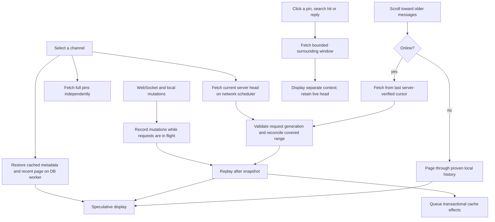

# Message history, cache and navigation audit

This audit covers the frontend and `papo-core`. No changes to papo-backend are required. The existing `GET /channels/:channel_id/messages` endpoint supports directional pagination with the exact `(since, last_id)` cursor and `order=asc|desc`.

## Data flow

Metadata restores at runtime startup. Message pages restore asynchronously for the selected channel. Neither a cache hit nor selecting a channel makes it fresh or marks its messages as read. The server snapshot establishes freshness only for its connection generation. Runtime/session ownership protects server and account boundaries; request IDs additionally protect individual page, context and pin loads.

## Findings and corrections

| Finding | Consequence | Correction |
| --- | --- | --- |
| Jump only scrolled to rows already in memory; an unresolved jump also disabled pagination and disappeared after ten seconds | Clicking an ancient pin appeared to do nothing | Explicit, cancellable context fetch; visible loading and errors; loaded replies use the same navigation path |
| Cached full pins shared the chronological message list | An isolated ancient pin could become the pagination cursor and skip the intervening history | Separate pin snapshots and timeline membership, both in memory and in persistence |
| Pagination used the oldest displayed/cached message as the server boundary | Cache hits skipped revalidation of old server edits/deletions | Separate exact server cursor; online pages revalidate cached rows in their covered range; offline pagination uses the local cursor |
| Cache restoration could overwrite already projected messages | A late DB read could undo live edits or fresh context data | Cache hydration fills missing chronological rows only; it cannot update the separate fresh context |
| History requests ran inside the network command loop | A slow GET delayed processing WebSocket events and other commands | History, context and pin reads use the bounded scheduler |
| Head loading awaited the pin query | Slow pins delayed displaying an otherwise available message head | Fetch pins independently; keep cached pins visible during refresh |
| Older pages and pin snapshots lacked request ownership and mutation replay | A late response could resurrect a deletion, reverse a pin, or merge into a different connection/window | Generation/request tickets and mutation journals; cancellation makes obsolete completions inert |
| Head reconciliation deleted stale rows only if loaded in memory | Deleted messages still on disk could reappear later | Delete absent rows across the entire authoritative head range, including disk-only rows |
| Accepted pages were stored as unrelated individual upserts | A dropped earlier write or retention could leave a disconnected segment looking continuous | Atomic checked append: a page extends cached coverage only when its boundary remains a proven timeline row in the database |
| Generic message/pin/send upserts implied continuity | One standalone message could falsely bridge a history gap | Standalone upserts preserve metadata without creating timeline membership; only snapshots and checked appends establish coverage |
| Cached message times rounded to milliseconds | Equal-millisecond page boundaries could omit or reorder messages | Persist the full fractional second and use timestamp precision plus ID in local and server cursors |
| Pin retention could delete rows inside chronological history | Retention could punch holes in a supposedly continuous cache | Bound the chronological suffix independently; auxiliary metadata/pin eviction only removes rows outside that suffix |
| Older history loaded only within 360 points of the top and required overflow | Slow requests arrived too late; a short first page could strand large windows | Fetch within the shared upper runway, including when the first page fits the viewport |

## Existing API used for context navigation

For a known target timestamp `T` and ID `M`:

1. `GET /channels/C/messages?since=T&last_id=M&order=desc&limit=30` returns preceding messages.
2. Find the immediate predecessor `P`. Request `GET /channels/C/messages?since=P.created_at&last_id=P.id&order=asc&limit=31`. This returns the target itself, freshly hydrated, followed by newer messages. If there is no predecessor, request the first ascending page without a cursor.

The combined window contains up to 30 preceding messages, the target, and 30 following messages. `has_more` from each direction controls further pagination. Timestamp precision and ID ordering are preserved even when many messages share exactly the same timestamp. Missing/deleted targets produce an error instead of displaying stale pin/search content.

Pins and search hits already supply timestamps. In the local backend implementation, `last_id` without `since` does not locate a message: the query ignores that ID as a cursor. An unloaded reply or notification with only an opaque ID therefore needs a descending seek to locate its exact cursor first. This seek is cancellable, uses bounded pages, and does not inject intermediate pages into the chat or its cache. An ID-only lookup on the existing backend endpoint would make that particular case faster; it is not required for pin/search jumps.

A context window is a separate view, not a disconnected insertion into the live timeline. New messages continue into the live head. Edits, deletions, pins, reactions and moderation updates affect loaded copies. Scrolling can extend the context in either direction. The down-arrow/Escape returns to the live head; sending also returns there so the optimistic echo remains visible. Merely viewing a distant context does not mark the unseen interval as read.

## Persistence contract

Schema 19 adds explicit `timeline` membership and `created_at_nanos` to cached messages. Initial/older pages contain chronological rows only; initial hydration also returns a separate bounded pin snapshot. A pin that is genuinely part of a fetched chronological page remains a normal chronological row as well.

A successful server head replaces only the range it covers. Older proven history can survive when there is a real overlapping timeline message, including an own message. A standalone send or pin is not overlap evidence. Without overlap, the old chronological region is discarded and must be refetched. Checked historical appends additionally reconcile edits/deletions within their covered range. A failed cache write never turns a later disconnected page into usable chronological coverage. If an append loses its boundary, those rows remain snapshots until a later head reconciliation re-establishes continuous coverage.

Chronological rows and detached metadata have independent bounded retention, so pressure from standalone acknowledgements cannot remove interior rows of a proven timeline.

The DB worker batches accepted writes transactionally and runs retention at the end of the batch. Chronological cache pages and older pages in the live-history path sort once per batch rather than repeatedly sorting all loaded messages after every row. Message rows, attachment metadata, reactions, embeds and external-author metadata travel together. Decoded media/player resources retain their separate lifetimes.

The migration rebuilds previously unproven chronological cache once. It preserves retained pins, read state, drafts, credentials and queued sends. Ordinary history becomes available again from the server; until refetched it is unavailable offline. The cache cannot infer continuity retroactively from arbitrary legacy rows.

Context windows remain session-local and are not persisted as extra timeline segments. Restart restores the recent proven history and retained pins. This intentionally avoids treating the unrequested interval between a distant context and the live head as cached history. Historical pages in the continuous head path do persist normally.

## Scrolling and media

The media runway is shared by message previews and attachment loading: 1,800 points above and 480 below the readable area, increased from 1,200/320. History pagination begins in the upper runway too. Existing visible-message anchoring remains responsible for compensating row-height changes; earlier fetching reduces the amount of layout work arriving at the visible edge. Context jumps use an immediate scroll, followed by the existing highlight.

Frame-by-frame inspection of `Replay_2026-10-18_00-24-18.mp4` from 57 seconds through the end (294 consecutive frames) found a one-frame history flash at 58.483 seconds. The channel opens around 58.250 seconds; recent messages are visible before and after the flash, but the flash shows substantially older messages. A headless regression reproduced this when history is prepended while the viewport is stuck to the bottom: egui updates the final scroll offset after laying out the rows, leaving that frame's geometry at the old offset. The frontend now compares the layout viewport with the returned offset when content resizes and repeats layout before presenting the frame. Ordinary wheel movement alone does not trigger this extra pass. Tests cover prepending at the bottom and preview expansion/contraction there, alongside the existing scrolled-away anchoring tests.

## Verification

Regression tests exercise directional HTTP requests against a local mock of the existing endpoint, including the first/last message, exact timestamp ties, fresh target hydration and deleted targets. Store tests cover separate windows, both pagination directions, cancellation/supersession, reconnects, concurrent edits/deletes/pins, stale cache reads, all-own overlap, online historical revalidation, read-frontier isolation and malformed pages. Real DB tests cover detached pins, missing append anchors, range deletion, retention and fractional-timestamp round trips. Existing headless scrolling tests cover prepending history, simultaneous row growth above/below the viewport and wheel input during relayout.

Live scrolling with real media still needs a visual recheck on the user's desktop; passing state/layout tests is not a claim that all perceived jumps are gone.
